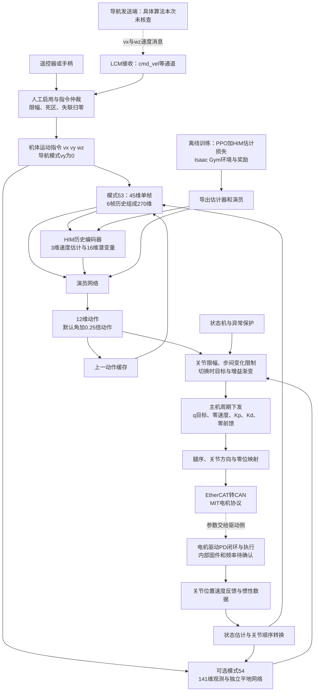

# 强化学习与运动控制代码分析

海报题目：《基于强化学习与自主导航的四足电力巡检机器人》

检查日期：2026-11-09（香港时间）。检查范围：当前 HIMLoco 工作区，以及本机可读的 `/home/xjtx/rl-deploy/Cheetah-Software-RL` 部署仓库。未修改源代码、启动训练或仿真、运行硬件程序、安装依赖。本次仅阅读代码、配置、已有日志与模型图，计算文件哈希，并生成本报告。

版本边界：HIMLoco 当前提交 `0113366`；楼梯播放脚本存在检查前即有的未提交修改，本文按磁盘实际内容分析，保留该修改。部署仓库当前提交 `be681c6`，检查时工作树无改动。以下“当前”指这些本地文件，不代表机器人上正在运行的二进制。

## 1. 核心结论

1. Mini Cheetah 训练使用 **PPO（近端策略优化）+ HIM（混合内部模型）历史观测估计模块**，代码类为 `HIMPPO`、`HIMActorCritic`。基于 PyTorch（深度学习框架）、本地 rsl_rl（强化学习库）与 legged_gym（足式机器人训练环境），调用 Isaac Gym（机器人仿真平台）；已有评测明确记录 GPU PhysX（显卡物理引擎）。不是仅从模型文件名推测算法。[him_ppo.py:153](/home/xjtx/rl/HIMLoco/rsl_rl/rsl_rl/algorithms/him_ppo.py:153)、[him_on_policy_runner.py:66](/home/xjtx/rl/HIMLoco/rsl_rl/rsl_rl/runners/him_on_policy_runner.py:66)、[metadata.json:4](/home/xjtx/rl/HIMLoco/legged_gym/logs/policy_eval_20261106_1637_latest_stairs/stairs_0.5/metadata.json:4)。
2. 当前策略输入为每帧 45 维、6 帧共 270 维，输出 **12 维归一化关节位置偏置**，经 `q目标=q默认+0.25×裁剪后的动作` 转换。这里“归一化”是动作缩放约定，不表示动作被限制在 ±1；实际裁剪阈值为 ±100。[minich_config.py:7](/home/xjtx/rl/HIMLoco/legged_gym/legged_gym/envs/minich/minich_config.py:7)、[legged_robot.py:100](/home/xjtx/rl/HIMLoco/legged_gym/legged_gym/envs/base/legged_robot.py:100)、[legged_robot.py:802](/home/xjtx/rl/HIMLoco/legged_gym/legged_gym/envs/base/legged_robot.py:802)。
3. 训练仿真在主机端计算关节 **PD（比例—微分）** 力矩并限幅；实机部署分支下发位置目标、零速度目标、Kp/Kd 和零前馈力矩，经 EtherCAT（实时工业以太网）转 CAN（控制器局域网络）发送 MIT 电机协议。当前主机链路把关节 PD 参数交给驱动侧执行；电机内部闭环、驱动固件及实际执行频率没有在本次材料中确认。[legged_robot.py:808](/home/xjtx/rl/HIMLoco/legged_gym/legged_gym/envs/base/legged_robot.py:808)、[RLControlContext.cpp:514](/home/xjtx/rl-deploy/Cheetah-Software-RL/user/MIT_Controller/FSM_States/RLControlContext.cpp:514)、[HardwareBridge.cpp:520](/home/xjtx/rl-deploy/Cheetah-Software-RL/robot/src/HardwareBridge.cpp:520)、[rt_ethercat.cpp:784](/home/xjtx/rl-deploy/Cheetah-Software-RL/robot/src/rt/rt_ethercat.cpp:784)。
4. 已有训练标量日志、270→12 的导出模型、历史受控楼梯仿真评测，以及历史实机目录下的通信记录。**不能据此宣称当前模型完成实机越障或自主电力巡检验证。** 本地部署 `policy.onnx` 与 10 月 19 日导出文件字节一致，而最新训练导出来自 11 月 7 日，两者不同；部署旁的说明文档已经滞后。
5. 导航接口已经写入部署代码：接收前向速度 `vx` 与偏航角速度 `wz`，经人工启用、限幅、超时处理后进入策略观测，侧向速度置零。接口存在不等于导航模块已经联调完成；导航触发平地/楼梯控制器切换的编译开关当前为 **0，仅打印**。[HardwareBridge.cpp:56](/home/xjtx/rl-deploy/Cheetah-Software-RL/robot/src/HardwareBridge.cpp:56)、[NavigationCommand.h:21](/home/xjtx/rl-deploy/Cheetah-Software-RL/robot/include/rt/NavigationCommand.h:21)、[rt_rc_interface.cpp:110](/home/xjtx/rl-deploy/Cheetah-Software-RL/robot/src/rt/rt_rc_interface.cpp:110)。

## 2. 算法与代码证据表

证据状态定义：**存在**＝有实现；**启用**＝当前配置或入口选择；**训练/导出**＝有实际产物或日志；**仿真记录**＝已有仿真档案；**历史硬件记录**＝实机目录中的既有通信数据，但还需匹配模型、固件和场景。各层证据不能相互替代。

| 技术环节 | 实际算法或方法 | 关键配置 | 证据文件与行号 | 证据状态 | 不确定事项 |
|---|---|---|---|---|---|
| 任务入口 | 任务注册后构造环境和训练器 | `--task minich`；不带参数默认 `aliengo` | [helpers.py:182](/home/xjtx/rl/HIMLoco/legged_gym/legged_gym/utils/helpers.py:182)；[train.py:141](/home/xjtx/rl/HIMLoco/legged_gym/legged_gym/scripts/train.py:141)；[注册入口](/home/xjtx/rl/HIMLoco/legged_gym/legged_gym/envs/__init__.py:43) | 启用路径明确 | 不能把 IDE 打开的配置当作命令行实际选择 |
| 算法实例化 | `HIMOnPolicyRunner → HIMActorCritic + HIMPPO` | 训练器在注册工厂中直接实例化 | [工厂](/home/xjtx/rl/HIMLoco/legged_gym/legged_gym/utils/task_registry.py:147)；[him_on_policy_runner.py:66](/home/xjtx/rl/HIMLoco/rsl_rl/rsl_rl/runners/him_on_policy_runner.py:66) | 当前默认训练链 | 没有默认选择 SAC（软演员—评论家算法）的证据 |
| 强化学习更新 | 裁剪概率比目标、价值损失、熵正则、自适应学习率 | 比率裁剪 0.2；熵系数 0.01 | [him_ppo.py:138](/home/xjtx/rl/HIMLoco/rsl_rl/rsl_rl/algorithms/him_ppo.py:138)；[him_ppo.py:155](/home/xjtx/rl/HIMLoco/rsl_rl/rsl_rl/algorithms/him_ppo.py:155)；[legged_robot_config.py:278](/home/xjtx/rl/HIMLoco/legged_gym/legged_gym/envs/base/legged_robot_config.py:278) | 存在且启用，日志有更新记录 | 训练参数可被启动参数覆盖 |
| 优势估计 | GAE（广义优势估计）递推 | γ=0.99，λ=0.95 | [存储与递推](/home/xjtx/rl/HIMLoco/rsl_rl/rsl_rl/storage/him_rollout_storage.py:104) | 当前算法调用 | 不等于独立原创算法 |
| 策略网络 | 非对称 Actor-Critic（演员—评论家）+历史估计器 | 当前 270 维历史、238 维评论家、12 动作 | [him_actor_critic.py:74](/home/xjtx/rl/HIMLoco/rsl_rl/rsl_rl/modules/him_actor_critic.py:74)；[him_actor_critic.py:96](/home/xjtx/rl/HIMLoco/rsl_rl/rsl_rl/modules/him_actor_critic.py:96)；[him_estimator.py:35](/home/xjtx/rl/HIMLoco/rsl_rl/rsl_rl/modules/him_estimator.py:35) | 启用；导出图结构已读 | 部署模式 54 是另一套网络 |
| 仿真与模型 | Isaac Gym + PhysX（物理引擎），Mini Cheetah 机器人描述模型 | 4096 环境；三角网格地形 | [train.py:38](/home/xjtx/rl/HIMLoco/legged_gym/legged_gym/scripts/train.py:38)；[minich_config.py:8](/home/xjtx/rl/HIMLoco/legged_gym/legged_gym/envs/minich/minich_config.py:8)；[minich_config.py:68](/home/xjtx/rl/HIMLoco/legged_gym/legged_gym/envs/minich/minich_config.py:68)；[metadata.json:4](/home/xjtx/rl/HIMLoco/legged_gym/logs/policy_eval_20261106_1637_latest_stairs/stairs_0.5/metadata.json:4) | 代码启用；历史 GPU 仿真记录 | 本次未运行仿真；不从 README 推定已安装版本 |
| 观测 | 指令、角速度、重力方向、关节状态、上一动作 | 45×6=270；评论家 45+3+3+187=238 | [legged_robot.py:405](/home/xjtx/rl/HIMLoco/legged_gym/legged_gym/envs/base/legged_robot.py:405)；[minich_config.py:7](/home/xjtx/rl/HIMLoco/legged_gym/legged_gym/envs/minich/minich_config.py:7) | 当前启用；最新导出 270 维 | 历史另有 47×6=282 的策略 |
| 动作与关节控制 | 位置偏置 → 位置目标 → PD 力矩 | 0.25 rad/动作单位；仿真 Kp=17/24，Kd=0.4/0.8 | [minich_config.py:43](/home/xjtx/rl/HIMLoco/legged_gym/legged_gym/envs/minich/minich_config.py:43)；[minich_config.py:60](/home/xjtx/rl/HIMLoco/legged_gym/legged_gym/envs/minich/minich_config.py:60)；[legged_robot.py:790](/home/xjtx/rl/HIMLoco/legged_gym/legged_gym/envs/base/legged_robot.py:790) | 当前训练启用 | 训练与部署增益不同 |
| 奖励 | 速度跟踪、姿态、载荷、平滑、足端事件等 | 运行时非零权重乘控制周期，总奖励截负值 | [minich_config.py:80](/home/xjtx/rl/HIMLoco/legged_gym/legged_gym/envs/minich/minich_config.py:80)；[legged_robot.py:364](/home/xjtx/rl/HIMLoco/legged_gym/legged_gym/envs/base/legged_robot.py:364)；[legged_robot.py:1122](/home/xjtx/rl/HIMLoco/legged_gym/legged_gym/envs/base/legged_robot.py:1122)；[reward_weights.json:21](/home/xjtx/rl/HIMLoco/legged_gym/logs/rough_minich/Nov07_10-58-27_smoke_minich/reward_weights.json:21) | 当前配置；11 月 7 日权重记录 | 正奖励系数可能乘有符号事件分数；高总奖励不是成功率 |
| 训练增强 | 地形课程、摩擦/质量/质心/增益随机化、噪声、推扰及动作延迟 | 详见下文 | [legged_robot_config.py:132](/home/xjtx/rl/HIMLoco/legged_gym/legged_gym/envs/base/legged_robot_config.py:132)；[legged_robot.py:528](/home/xjtx/rl/HIMLoco/legged_gym/legged_gym/envs/base/legged_robot.py:528)；[legged_robot.py:595](/home/xjtx/rl/HIMLoco/legged_gym/legged_gym/envs/base/legged_robot.py:595)；[legged_robot.py:948](/home/xjtx/rl/HIMLoco/legged_gym/legged_gym/envs/base/legged_robot.py:948) | 多项实际接线启用 | 电机强度随机量被采样，但未进入当前力矩公式 |
| 导出与加载 | ONNX（开放神经网络交换格式）；包含估计器和演员 | 270→12；部署 ONNX Runtime（模型推理运行库） | [train.py:121](/home/xjtx/rl/HIMLoco/legged_gym/legged_gym/scripts/train.py:121)；[helpers.py:220](/home/xjtx/rl/HIMLoco/legged_gym/legged_gym/utils/helpers.py:220)；[helpers.py:280](/home/xjtx/rl/HIMLoco/legged_gym/legged_gym/utils/helpers.py:280)；[RapidRLPolicyRunner.cpp:78](/home/xjtx/rl-deploy/Cheetah-Software-RL/user/MIT_Controller/FSM_States/RapidRLPolicyRunner.cpp:78) | 代码与实际导出产物 | 本机默认模型不是最新训练模型 |
| 仿真验证 | 独立楼梯播放、受控固定场景评测 | 当前播放高 15 cm、20 阶；旧评测高 8 cm | [play_minich_stairs.py:22](/home/xjtx/rl/HIMLoco/legged_gym/legged_gym/scripts/play_minich_stairs.py:22)；[report.md:5](/home/xjtx/rl/HIMLoco/legged_gym/logs/policy_eval_20261106_1637_latest_stairs/report.md:5)；[metadata.json:4](/home/xjtx/rl/HIMLoco/legged_gym/logs/policy_eval_20261106_1637_latest_stairs/stairs_0.5/metadata.json:4) | 播放代码存在；旧评测有运行记录 | 当前播放配置不能冒充已完成评测 |
| 导航输入 | LCM（轻量通信与编组）速度消息和人工/导航仲裁 | `vx,wz`；导航限幅 ±0.8；失联 1 秒归零 | [HardwareBridge.cpp:59](/home/xjtx/rl-deploy/Cheetah-Software-RL/robot/src/HardwareBridge.cpp:59)；[HardwareBridge.cpp:131](/home/xjtx/rl-deploy/Cheetah-Software-RL/robot/src/HardwareBridge.cpp:131)；[NavigationCommand.h:10](/home/xjtx/rl-deploy/Cheetah-Software-RL/robot/include/rt/NavigationCommand.h:10)；[rt_rc_interface.cpp:110](/home/xjtx/rl-deploy/Cheetah-Software-RL/robot/src/rt/rt_rc_interface.cpp:110) | 接口代码启用 | 未核查导航发送端和实机端到端链路 |
| 双策略选择 | 53=历史观测策略；54=独立平地策略 | 导航切换开关 0；人工选择可用 | [模式定义](/home/xjtx/rl-deploy/Cheetah-Software-RL/robot/include/rt/rt_rc_interface.h:62)；[编译缓存](/home/xjtx/rl-deploy/Cheetah-Software-RL/build-onnx/CMakeCache.txt:439) | 代码及本地构建配置 | 无法凭构建目录确认机器人已更新 |
| 状态估计 | 惯性姿态处理、接触估计、线性卡尔曼位置速度估计 | 非作弊分支选择对应估计器 | [RobotRunner.cpp:237](/home/xjtx/rl-deploy/Cheetah-Software-RL/robot/src/RobotRunner.cpp:237)；[RLControlContext.cpp:301](/home/xjtx/rl-deploy/Cheetah-Software-RL/user/MIT_Controller/FSM_States/RLControlContext.cpp:301) | 部署路径存在 | 不能把线性卡尔曼滤波写成扩展卡尔曼滤波 |
| 电机通信 | EtherCAT 转 CAN，位置/速度/增益/前馈协议 | 1 ms 通信任务；每电机 3 轮更新 | [HardwareBridge.cpp:383](/home/xjtx/rl-deploy/Cheetah-Software-RL/robot/src/HardwareBridge.cpp:383)；[HardwareBridge.cpp:495](/home/xjtx/rl-deploy/Cheetah-Software-RL/robot/src/HardwareBridge.cpp:495)；[rt_ethercat.cpp:776](/home/xjtx/rl-deploy/Cheetah-Software-RL/robot/src/rt/rt_ethercat.cpp:776) | 当前硬件分支 | 驱动内部控制周期、接线及报文实测未确认 |
| 安全机制 | 状态机、人工 OFF、姿态异常/非有限值/推理超时保护、目标限幅 | 滚转/俯仰 45°；平地另有 30°总倾角；推理超时 100 ms | [RLControlContext.cpp:21](/home/xjtx/rl-deploy/Cheetah-Software-RL/user/MIT_Controller/FSM_States/RLControlContext.cpp:21)；[RLControlContext.cpp:235](/home/xjtx/rl-deploy/Cheetah-Software-RL/user/MIT_Controller/FSM_States/RLControlContext.cpp:235)；[RLControlContext.cpp:596](/home/xjtx/rl-deploy/Cheetah-Software-RL/user/MIT_Controller/FSM_States/RLControlContext.cpp:596)；[RobotRunner.cpp:109](/home/xjtx/rl-deploy/Cheetah-Software-RL/robot/src/RobotRunner.cpp:109) | 实现存在 | 目标跟踪偏差超过 1.2 rad 仅告警，不是急停 |
| 历史结果 | 仿真评测与历史通信采集 | 旧楼梯 2/12 对 9/12；硬件目录约 62 秒记录 | [report.md:3](/home/xjtx/rl/HIMLoco/legged_gym/logs/policy_eval_20261106_1637_latest_stairs/report.md:3)；[summary.json:1](/home/xjtx/rl/HIMLoco/legged_gym/real-robot-lcm/record.lcm.00_analysis/summary.json:1) | 仿真记录、历史硬件记录 | 不是当前模型或竞赛场景实测指标 |

### 2.1 实际代码路径、默认选择与启动流程

工作区主体为 `legged_gym/`（环境、机器人资源、训练/播放/导出脚本、日志）和 `rsl_rl/`（算法、网络、采样存储、训练器）；`projects/` 主要是不同研究方向介绍；`logs/` 与 `legged_gym/logs/` 不能混为同一日志根。默认工厂以 `LEGGED_GYM_ROOT_DIR/logs/rough_minich` 写入 Mini Cheetah 日志，本次实际产物位于 `legged_gym/logs/rough_minich`。[日志根](/home/xjtx/rl/HIMLoco/legged_gym/legged_gym/utils/task_registry.py:138)。

训练入口的调用关系是 `scripts/train.py → get_args → task_registry.make_env → LeggedRobot(MiniChRoughCfg) → make_alg_runner → HIMOnPolicyRunner → HIMPPO`。应使用 `--task minich` 选择本机型；存在 A1、Go1、AlienGo 配置不代表它们同时被训练。基类默认 `resume=False`，因此 `load_run` 的存在不表示恢复训练。[恢复开关](/home/xjtx/rl/HIMLoco/legged_gym/legged_gym/envs/base/legged_robot_config.py:304)。本次没有执行任何训练命令。

仓库包含普通 `ppo.py`、普通/循环演员—评论家实现，但注册工厂和当前训练配置选用 HIM 系列；不能把循环网络或 H∞（无穷范数鲁棒控制）写成当前默认算法。项目介绍列出 H∞ 方向不能替代实际调用链。

模型加载由训练器完成；一般 `play.py`、`play_minich_flat_height.py` 和 `play_minich_stairs.py` 用于仿真。当前楼梯播放脚本强制 `args.task='minich'`，三台机器人均设置 `(-1,-1)`，即按辅助函数选择最近运行目录和最后模型；10 月 23 日指定模型只在注释中。根据当前目录与日期排序规则，最近训练目录为 `Nov07_10-58-27_smoke_minich`，其中模型为 `model_1000.pt`。当前播放设定 15 cm 高、20 cm 踏面、20 阶，速度均值 0.5、振幅 0.5 m/s，即 **0～1 m/s**；旁边“0.4～0.6”注释不符合参数。2 Hz 楼梯相位覆盖参数存在，但当前 45 维配置关闭相位时钟，不能写成当前策略具有 2 Hz CPG（中枢模式发生器）。[play_minich_stairs.py:22](/home/xjtx/rl/HIMLoco/legged_gym/legged_gym/scripts/play_minich_stairs.py:22)、[play_minich_stairs.py:33](/home/xjtx/rl/HIMLoco/legged_gym/legged_gym/scripts/play_minich_stairs.py:33)、[play_minich_stairs.py:234](/home/xjtx/rl/HIMLoco/legged_gym/legged_gym/scripts/play_minich_stairs.py:234)、[helpers.py:120](/home/xjtx/rl/HIMLoco/legged_gym/legged_gym/utils/helpers.py:120)。

训练每 1000 次学习迭代导出一次 ONNX，并在 `finally` 中导出 `latest.onnx`；后者也可能是中断训练时的模型，不能按名字认定训练完成。独立导出入口 [export_minich_onnx.py](/home/xjtx/rl/HIMLoco/legged_gym/legged_gym/scripts/export_minich_onnx.py:130) 会记录模型哈希、输入输出及数值校验信息。导出推理图保留估计器、潜变量归一化和演员，剔除评论家；调用方负责观测与动作处理。[train.py:145](/home/xjtx/rl/HIMLoco/legged_gym/legged_gym/scripts/train.py:145)、[helpers.py:280](/home/xjtx/rl/HIMLoco/legged_gym/legged_gym/utils/helpers.py:280)。

部署入口在相邻仓库：[main.cpp](/home/xjtx/rl-deploy/Cheetah-Software-RL/user/MIT_Controller/main.cpp:12) → [main_helper.cpp](/home/xjtx/rl-deploy/Cheetah-Software-RL/robot/src/main_helper.cpp:34) → `SimulationBridge` 或 `MiniCheetahHardwareBridge` → `RobotRunner` → `MIT_Controller` → `ControlFSM`。参数 `m` 表示 Mini Cheetah，`s/r` 分别选择仿真/真实硬件，实机可选 `f` 从文件读参数，否则从网络读。这里只解析入口，不执行程序，也不据此推定现场启动方式。

`ControlFSM` 支持被动、站起、恢复站立、传统运动控制及两种强化学习状态；控制器选择由遥控/控制参数触发，并非启动后自动进入强化学习运动。[状态机](/home/xjtx/rl-deploy/Cheetah-Software-RL/user/MIT_Controller/FSM_States/ControlFSM.cpp:110)。默认 ONNX 文件在 [CMakeLists.txt:29](/home/xjtx/rl-deploy/Cheetah-Software-RL/CMakeLists.txt:29) 指向 `rl-checkpoints/onnx/policy.onnx`；本机 `build-onnx` 缓存也是该路径，仍需机器人实际二进制与启动日志确认。

### 2.2 算法与网络结构

`HIMPPO.update()` 计算新旧策略对数概率之差的指数得到概率比，对比未裁剪与裁剪后的优势目标；损失含价值回归和负熵项。Adam（自适应矩估计优化器）更新参数；根据 KL（相对熵）调整学习率。采样存储利用 `δ=r+γV下一步−V当前`、`A=δ+γλA下一步` 计算优势并标准化。这是明确的 PPO 算法证据。[him_ppo.py:67](/home/xjtx/rl/HIMLoco/rsl_rl/rsl_rl/algorithms/him_ppo.py:67)、[him_ppo.py:138](/home/xjtx/rl/HIMLoco/rsl_rl/rsl_rl/algorithms/him_ppo.py:138)、[him_ppo.py:155](/home/xjtx/rl/HIMLoco/rsl_rl/rsl_rl/algorithms/him_ppo.py:155)。

当前网络结构如下，箭头数字表示维度：

- 历史编码器：`270 → 128 → 64 → 19`，分成 3 维机体线速度估计与 16 维潜变量；潜变量作 L2（二范数）归一化。
- 演员：`45当前帧 + 3估计速度 + 16潜变量 = 64 → 512 → 256 → 128 → 12`。
- 评论家：`238 → 512 → 256 → 128 → 1`，训练时使用额外的仿真真值信息。
- 隐藏层使用 ELU（指数线性单元）；演员输出层没有启用双曲正切。训练动作从可学习标准差的高斯分布采样；推理输出均值。`is_recurrent=False`，6 帧拼接不是循环网络。[him_actor_critic.py:74](/home/xjtx/rl/HIMLoco/rsl_rl/rsl_rl/modules/him_actor_critic.py:74)、[him_actor_critic.py:99](/home/xjtx/rl/HIMLoco/rsl_rl/rsl_rl/modules/him_actor_critic.py:99)、[him_actor_critic.py:166](/home/xjtx/rl/HIMLoco/rsl_rl/rsl_rl/modules/him_actor_critic.py:166)、[him_estimator.py:64](/home/xjtx/rl/HIMLoco/rsl_rl/rsl_rl/modules/him_estimator.py:64)。

估计器额外使用速度均方误差和原型交换损失，含 32 个原型与 Sinkhorn（矩阵归一化）分配；目标分支 `45→128→64→16` 只用于训练。精确地说，当前代码的目标输入切片为 `next_critic_obs[:,3:48]`，速度监督为 `[:,45:48]`，不是直接完整复制当前演员的 45 维输入。不能将这一结构描述为已经实现单独训练教师再蒸馏学生的两阶段系统；也没有在线更新网络参数的实机自适应训练路径。适合海报写“利用历史观测估计运动状态与隐含特征”。[him_estimator.py:44](/home/xjtx/rl/HIMLoco/rsl_rl/rsl_rl/modules/him_estimator.py:44)、[him_estimator.py:76](/home/xjtx/rl/HIMLoco/rsl_rl/rsl_rl/modules/him_estimator.py:76)。

### 2.3 观测维度、坐标系、缩放与历史

下表为当前 45 维单帧的实际拼接顺序。机体坐标按机器人前向 x、侧向 y、竖向 z 的运动控制约定解释；角速度、重力及训练线速度由四元数逆旋转到机体系。导航输入不进行世界坐标到机体坐标转换，发送端必须按该约定供给。[legged_robot.py:148](/home/xjtx/rl/HIMLoco/legged_gym/legged_gym/envs/base/legged_robot.py:148)、[legged_robot.py:408](/home/xjtx/rl/HIMLoco/legged_gym/legged_gym/envs/base/legged_robot.py:408)、[RapidRLPolicyConfig.h:193](/home/xjtx/rl-deploy/Cheetah-Software-RL/user/MIT_Controller/FSM_States/RapidRLPolicyConfig.h:193)。

| 索引（左闭右开） | 内容 | 原始单位/坐标 | 缩放 | 训练时均匀噪声幅度（缩放后） |
|---|---|---|---|---|
| 0:3 | vx、vy、偏航角速度指令 | m/s、m/s、rad/s；局部机体运动指令 | `[2,2,0.25]` | 0 |
| 3:6 | 机体角速度 | rad/s，机体系 | 0.25 | ±0.05 |
| 6:9 | 重力单位方向 | 无量纲，机体系；水平时约 `[0,0,-1]` | 1 | ±0.05 |
| 9:21 | 12 关节位置减默认角 | rad | 1 | ±0.01 |
| 21:33 | 12 关节速度 | rad/s | 0.05 | ±0.075 |
| 33:45 | 上一控制周期动作 | 无量纲；动作裁剪后的值 | 1 | 0 |

合计 `3+3+3+12+12+12=45`。每次把新帧放在历史最前，保留 5 个旧帧，得 270 维；名义采样间隔 20 ms，最新至最旧跨 100 ms。训练重置后用同一首帧重复填满历史，避免上一回合残留。固定缩放后加噪声，输出观测整体裁剪到 ±100；不是在线均值方差标准化。[legged_robot.py:128](/home/xjtx/rl/HIMLoco/legged_gym/legged_gym/envs/base/legged_robot.py:128)、[legged_robot.py:429](/home/xjtx/rl/HIMLoco/legged_gym/legged_gym/envs/base/legged_robot.py:429)、[legged_robot.py:948](/home/xjtx/rl/HIMLoco/legged_gym/legged_gym/envs/base/legged_robot.py:948)、[legged_robot_config.py:219](/home/xjtx/rl/HIMLoco/legged_gym/legged_gym/envs/base/legged_robot_config.py:219)。

评论家额外输入为机体系线速度 3 维（m/s，乘 2）、局部外力 3 维（N，无额外缩放）和 187 个地形高度采样；总计 `45+3+3+187=238`，当前无评论家历史堆叠。高度采样为 17×11 点、围绕机身按偏航对齐；实际特征为 `clip(z机身−0.5−z地形,−1,1)×5`，另加最高 ±0.5 的高度噪声。高度不是当前演员输入，也不是来自视觉识别。特别是高度加噪代码在 `measure_heights` 分支中执行，不受上方 `if self.add_noise` 直接包围；修改播放噪声时必须看实际配置处理，不能只读开关。[legged_robot_config.py:55](/home/xjtx/rl/HIMLoco/legged_gym/legged_gym/envs/base/legged_robot_config.py:55)、[legged_robot.py:423](/home/xjtx/rl/HIMLoco/legged_gym/legged_gym/envs/base/legged_robot.py:423)、[高度采样](/home/xjtx/rl/HIMLoco/legged_gym/legged_gym/envs/base/legged_robot.py:1488)。

历史 47 维版本增加两个楼梯相位量，对应演员 282、评论家 240；当前已关闭。部署加载器严格要求 270→12，不能直接使用 282 输入模型。[minich_config.py:9](/home/xjtx/rl/HIMLoco/legged_gym/legged_gym/envs/minich/minich_config.py:9)、[RapidRLPolicyRunner.cpp:89](/home/xjtx/rl-deploy/Cheetah-Software-RL/user/MIT_Controller/FSM_States/RapidRLPolicyRunner.cpp:89)、[历史差异记录](/home/xjtx/rl/HIMLoco/legged_gym/logs/policy_eval_20261106_1637_latest_stairs/comparability.json:25)。

### 2.4 动作、默认姿态与控制公式

策略关节顺序为左前、右前、左后、右后，每条腿依次外展/髋、大腿、小腿。训练器按 Isaac Gym 返回的关节名映射默认姿态；不能直接按 URDF（统一机器人描述格式）文件文本出现顺序判断。历史仿真元数据记录了该实际顺序：[metadata.json:477](/home/xjtx/rl/HIMLoco/legged_gym/logs/policy_eval_20261106_1637_latest_stairs/stairs_0.5/metadata.json:477)；部署显式排列映射见 [RapidRLPolicyConfig.h:84](/home/xjtx/rl-deploy/Cheetah-Software-RL/user/MIT_Controller/FSM_States/RapidRLPolicyConfig.h:84)。

默认关节角（rad）为：`[0.1,-0.8,1.62, -0.1,-0.8,1.62, 0.1,-0.8,1.62, -0.1,-0.8,1.62]`。动作先裁剪到 ±100，再乘 0.25 加默认角；外展关节额外缩放 `hip_reduction=1`，不改变当前输出。不是直接输出力矩，也不是足端位置。[minich_config.py:45](/home/xjtx/rl/HIMLoco/legged_gym/legged_gym/envs/minich/minich_config.py:45)、[legged_robot.py:802](/home/xjtx/rl/HIMLoco/legged_gym/legged_gym/envs/base/legged_robot.py:802)。

训练公式：

`a = clip(网络动作, −100, 100)`  
`q目标 = q默认 + 0.25 a`  
`τ = clip(Kp·Kp随机因子·(q目标−q) − Kd·Kd随机因子·q̇, −τ限值, τ限值)`

当前外展/大腿 Kp=17 N·m/rad、Kd=0.4 N·m·s/rad，小腿 Kp=24、Kd=0.8；遍历名称时更具体的 `calf_joint` 覆盖普通 `joint`。这是带零速度目标的 PD，即使配置标签叫 `P`，也包含速度阻尼。没有积分项，不能称 PID（比例—积分—微分）。力矩限制来自机器人描述文件，当前外展/大腿 18 N·m、小腿 26 N·m。[legged_robot.py:1065](/home/xjtx/rl/HIMLoco/legged_gym/legged_gym/envs/base/legged_robot.py:1065)、[机器人限值](/home/xjtx/rl/HIMLoco/legged_gym/resources/robots/mini_cheetah/urdf/mini_cheetah.urdf:103)。

实机模式 53 配置 Kp=20、Kd=0.5；模式 54 为 17/0.4。主机发送 `q_des、qd_des=0、Kp、Kd、τ_ff=0`，接口含义为 `τ=Kp(q_des−q)+Kd(qd_des−q̇)+τ_ff` 的关节 PD/阻抗控制。主机 `LegController` 中同样形式的 `tauEstimate` 只是估计值，不应误写为主机已经算好全部关节 PD 力矩再下发。真正发送的是增益、目标和前馈分量；驱动固件是否完全遵守公式、内部电流环形式和频率仍待厂商资料/固件确认。[RapidRLPolicyConfig.h:62](/home/xjtx/rl-deploy/Cheetah-Software-RL/user/MIT_Controller/FSM_States/RapidRLPolicyConfig.h:62)、[RLControlContext.cpp:499](/home/xjtx/rl-deploy/Cheetah-Software-RL/user/MIT_Controller/FSM_States/RLControlContext.cpp:499)、[LegController.cpp:148](/home/xjtx/rl-deploy/Cheetah-Software-RL/common/src/Controllers/LegController.cpp:148)、[LegController.cpp:171](/home/xjtx/rl-deploy/Cheetah-Software-RL/common/src/Controllers/LegController.cpp:171)。

### 2.5 奖励：配置系数与实际计算

以下系数为当前 `MiniChRoughCfg.rewards.scales`，11 月 7 日运行快照也记录了这些非零项。普通项先计算下列数值，再乘配置系数和控制周期约 0.02 s；事件项先除以周期，因此总乘积表现为每次足端事件的奖励预算。最后总和负值被截为零，故总奖励上升不必然意味着跟踪或通行改善。[reward_weights.json:21](/home/xjtx/rl/HIMLoco/legged_gym/logs/rough_minich/Nov07_10-58-27_smoke_minich/reward_weights.json:21)、[legged_robot.py:364](/home/xjtx/rl/HIMLoco/legged_gym/legged_gym/envs/base/legged_robot.py:364)、[legged_robot.py:1122](/home/xjtx/rl/HIMLoco/legged_gym/legged_gym/envs/base/legged_robot.py:1122)。

| 奖励项 | 配置系数 | 实际计算/鼓励约束 |
|---|---:|---|
| `tracking_lin_vel` | +1 | 平面速度平方误差的指数；运动时除以 `0.25×clip(指令模长,0.3,1)^2`，指令模长低于 0.1 时使用固定 0.25，鼓励相对跟踪 |
| `tracking_ang_vel` | +1 | `exp(−偏航角速度误差²/0.25)` |
| `lin_vel_z` | −2 | 机体系竖向速度平方，抑制竖向晃动 |
| `ang_vel_xy` | −0.05 | 机体系滚转/俯仰角速度平方和 |
| `orientation` | −1.2 | 机身 z 轴与地形参考法向夹角超过 5°部分的平方；地形法向经过拟合、滤波和最大倾角约束 |
| `base_height` | −30 | 机身对局部地面高度与 0.26 m 的偏差平方 |
| `dof_acc` | −2.5e−7 | 相邻控制周期关节速度差除以周期后取平方和 |
| `joint_power` | −2e−5 | `Σ|q̇|·|τ|`；机械功率代理，不是电池耗电实测 |
| `torques` | −2e−4 | `Στ²`；当前控制周期所保存力矩，不是每个物理子步的尖峰统计 |
| `action_rate` | −0.01 | 相邻动作差的平方和 |
| `smoothness` | −0.01 | 动作二阶差分平方和 |
| `hip_mirror` | −1 | 原地转向门控下，左右外展角两两相加的绝对值之和，促进镜像姿态 |
| `hip_pos_penalty` | −1 | 原地转向时外展关节相对默认角超出 3°死区的偏差平方和 |
| `raibert_heuristic` | −10 | 有效腾空后触地时，足端 XY 与按速度命令推算目标落点的误差；仅训练奖励，不直接规划实机足端轨迹 |
| `turn_lift_frequency` | +0.25 | 转向时逐足统计 4 秒窗内满足约 1 cm 净空的抬脚事件覆盖，目标 0.5 Hz；实现分数可为负 |
| `turn_air_time_overdue` | −1 | 转向时腾空超过约 0.30 s 的代价 |
| `step_retraction` | +0.15 | 长踏面楼梯且速度/偏航门限满足时，每足每次摆动的有符号后摆事件得分；最佳有效后摆 1 cm，超时可扣分 |
| `swing_peak_height` | +0.1 | 同类楼梯门控下，每足摆动峰高事件得分；目标 5 cm，2.5～8 cm 评分范围，超时可扣分 |

计算依据：[legged_robot.py:1603](/home/xjtx/rl/HIMLoco/legged_gym/legged_gym/envs/base/legged_robot.py:1603)、[legged_robot.py:1632](/home/xjtx/rl/HIMLoco/legged_gym/legged_gym/envs/base/legged_robot.py:1632)、[legged_robot.py:1713](/home/xjtx/rl/HIMLoco/legged_gym/legged_gym/envs/base/legged_robot.py:1713)、[legged_robot.py:1761](/home/xjtx/rl/HIMLoco/legged_gym/legged_gym/envs/base/legged_robot.py:1761)、[legged_robot.py:1793](/home/xjtx/rl/HIMLoco/legged_gym/legged_gym/envs/base/legged_robot.py:1793)、[legged_robot.py:1920](/home/xjtx/rl/HIMLoco/legged_gym/legged_gym/envs/base/legged_robot.py:1920)、[legged_robot.py:2030](/home/xjtx/rl/HIMLoco/legged_gym/legged_gym/envs/base/legged_robot.py:2030)；事件实现见 [step_retraction.py:182](/home/xjtx/rl/HIMLoco/legged_gym/legged_gym/utils/step_retraction.py:182)、[swing_peak_height.py:83](/home/xjtx/rl/HIMLoco/legged_gym/legged_gym/utils/swing_peak_height.py:83)。事件门控并非适用于所有地形，当前只在实际长踏面楼梯等级 ≥2 等条件下执行。

**当前未启用**的项包括足端竖向载荷、质心居中、普通足端净空、传统腾空时间、碰撞奖励、终止奖励、关节位置/速度/力矩软限位奖励、楼梯相位力/高度/速度/对角缺额以及楼梯踏步奖励。奖励系数为零不等于没有硬件限幅或没有环境终止检查。例如躯干接触仍会重置训练环境，但 `termination` 奖励为零。[minich_config.py:88](/home/xjtx/rl/HIMLoco/legged_gym/legged_gym/envs/minich/minich_config.py:88)、[minich_config.py:95](/home/xjtx/rl/HIMLoco/legged_gym/legged_gym/envs/minich/minich_config.py:95)、[legged_robot.py:211](/home/xjtx/rl/HIMLoco/legged_gym/legged_gym/envs/base/legged_robot.py:211)。

### 2.6 课程、随机化与扰动：实际启用情况

| 方法 | 当前配置与实际接线 | 证据与边界 |
|---|---|---|
| 地形课程 | 开启，10 行难度×20 列地形；普通坡面、粗糙面、上下台阶和离散障碍；按行走距离/指令等调整等级 | [legged_robot_config.py:45](/home/xjtx/rl/HIMLoco/legged_gym/legged_gym/envs/base/legged_robot_config.py:45)；[地形生成](/home/xjtx/rl/HIMLoco/legged_gym/legged_gym/utils/terrain.py:69)；[legged_robot.py:889](/home/xjtx/rl/HIMLoco/legged_gym/legged_gym/envs/base/legged_robot.py:889) |
| 长踏面楼梯 | 15% 列，等级 0/1 平地、≥2 为 8 cm 高、1.20 m 踏面、2 阶 | [minich_config.py:18](/home/xjtx/rl/HIMLoco/legged_gym/legged_gym/envs/minich/minich_config.py:18)；这是训练地形，不是实机通行指标 |
| 指令课程 | Mini Cheetah 显式关闭；仍有速度/转向/站立采样 | [minich_config.py:28](/home/xjtx/rl/HIMLoco/legged_gym/legged_gym/envs/minich/minich_config.py:28)；不能把基类 `curriculum=True` 当成最终值 |
| 训练指令 | x/y 基本范围 ±1 m/s；转向抽样 ±1 rad/s；20% 低速组速度模长 0.2～0.5 m/s，侧向与航向生成偏航归零；另有长转向与转向转站立概率各 0.1 | [minich_config.py:28](/home/xjtx/rl/HIMLoco/legged_gym/legged_gym/envs/minich/minich_config.py:28)、[legged_robot_config.py:84](/home/xjtx/rl/HIMLoco/legged_gym/legged_gym/envs/base/legged_robot_config.py:84)、[legged_robot.py:617](/home/xjtx/rl/HIMLoco/legged_gym/legged_gym/envs/base/legged_robot.py:617)；正常航向模式按 `clip(0.5×航向差,−2,2)` 生成角速度，因此 ±1 不是所有训练步骤最终偏航指令硬限幅 |
| 摩擦 | 开启，0.2～1.25，赋给碰撞形状 | [legged_robot_config.py:142](/home/xjtx/rl/HIMLoco/legged_gym/legged_gym/envs/base/legged_robot_config.py:142)、[legged_robot.py:528](/home/xjtx/rl/HIMLoco/legged_gym/legged_gym/envs/base/legged_robot.py:528) |
| 质量/质心 | 基座附加质量 −1～2 kg；质心各轴 ±0.05 m，写入刚体属性 | [legged_robot_config.py:133](/home/xjtx/rl/HIMLoco/legged_gym/legged_gym/envs/base/legged_robot_config.py:133)、[legged_robot.py:595](/home/xjtx/rl/HIMLoco/legged_gym/legged_gym/envs/base/legged_robot.py:595) |
| 连杆质量/恢复系数 | 均关闭 | [minich_config.py:222](/home/xjtx/rl/HIMLoco/legged_gym/legged_gym/envs/minich/minich_config.py:222)；有实现不代表启用 |
| PD 增益 | Kp/Kd 随机因子分别 0.9～1.1，确实进入力矩公式 | [legged_robot_config.py:151](/home/xjtx/rl/HIMLoco/legged_gym/legged_gym/envs/base/legged_robot_config.py:151)、[legged_robot.py:808](/home/xjtx/rl/HIMLoco/legged_gym/legged_gym/envs/base/legged_robot.py:808) |
| 电机强度 | 开关为真并采样 0.9～1.1，但检索到的 `motor_strength_factors` 只有创建/重置赋值，当前 `_compute_torques` 没有使用 | [legged_robot.py:304](/home/xjtx/rl/HIMLoco/legged_gym/legged_gym/envs/base/legged_robot.py:304)、[legged_robot.py:808](/home/xjtx/rl/HIMLoco/legged_gym/legged_gym/envs/base/legged_robot.py:808)、[legged_robot.py:1097](/home/xjtx/rl/HIMLoco/legged_gym/legged_gym/envs/base/legged_robot.py:1097)；**不能写实际启用了电机强度扰动** |
| 初始关节 | 实际重置直接将默认姿态乘 0.5～1.5 随机因子；该重置语句未检查配置开关 | [legged_robot_config.py:157](/home/xjtx/rl/HIMLoco/legged_gym/legged_gym/envs/base/legged_robot_config.py:157)、[legged_robot.py:817](/home/xjtx/rl/HIMLoco/legged_gym/legged_gym/envs/base/legged_robot.py:817) |
| 动作延迟 | 开启，随机 0～3 个物理步沿用上一动作，再切换新动作 | [legged_robot.py:103](/home/xjtx/rl/HIMLoco/legged_gym/legged_gym/envs/base/legged_robot.py:103)；配置相当于 0～15 ms 延迟，不是连续插值滤波 |
| 外推扰动 | 每 16 秒随机设置世界系平面基座速度，每轴 ±1 m/s | [legged_robot_config.py:164](/home/xjtx/rl/HIMLoco/legged_gym/legged_gym/envs/base/legged_robot_config.py:164)、[legged_robot.py:860](/home/xjtx/rl/HIMLoco/legged_gym/legged_gym/envs/base/legged_robot.py:860)；是速度重置方式模拟推扰 |
| 外力扰动 | 每 8 个控制步施加局部三轴 ±30 N 随机力，约每 0.16 秒一次 | [legged_robot_config.py:160](/home/xjtx/rl/HIMLoco/legged_gym/legged_gym/envs/base/legged_robot_config.py:160)、[legged_robot.py:645](/home/xjtx/rl/HIMLoco/legged_gym/legged_gym/envs/base/legged_robot.py:645)、[legged_robot.py:867](/home/xjtx/rl/HIMLoco/legged_gym/legged_gym/envs/base/legged_robot.py:867)；`disturbance_interval=8` 按步计，不能写成 8 秒；不自动理解为持续 0.16 秒 |
| 观测噪声 | 开启，幅度见观测表 | [legged_robot_config.py:229](/home/xjtx/rl/HIMLoco/legged_gym/legged_gym/envs/base/legged_robot_config.py:229)、[legged_robot.py:948](/home/xjtx/rl/HIMLoco/legged_gym/legged_gym/envs/base/legged_robot.py:948) |

### 2.7 训练参数与实际记录

当前继承配置：4096 并行环境，20 秒单回合，100 步/环境/迭代，即 **409600 个环境转移/迭代**；每次更新 5 个训练轮次、4 个小批次，理论每批 102400 个样本；最大 200000 次迭代是配置上限，不是已经训练的数量。初始学习率 1e−3，自适应调整；γ=0.99、λ=0.95、目标 KL=0.01、梯度范数上限 1、价值损失系数 1、熵系数 0.01、初始动作标准差 1。[legged_robot_config.py:265](/home/xjtx/rl/HIMLoco/legged_gym/legged_gym/envs/base/legged_robot_config.py:265)、[minich_config.py:8](/home/xjtx/rl/HIMLoco/legged_gym/legged_gym/envs/minich/minich_config.py:8)。

仿真步长 0.005 s、控制降采样 4、`substeps=1`：策略周期 `4×0.005=0.020 s`，名义策略 **50 Hz**，力矩更新/物理推进 **200 Hz**。这些是仿真时间配置推算值，不是训练吞吐、墙钟时间实时性或电机固件控制频率。[legged_robot_config.py:246](/home/xjtx/rl/HIMLoco/legged_gym/legged_gym/envs/base/legged_robot_config.py:246)、[minich_config.py:65](/home/xjtx/rl/HIMLoco/legged_gym/legged_gym/envs/minich/minich_config.py:65)、[legged_robot.py:113](/home/xjtx/rl/HIMLoco/legged_gym/legged_gym/envs/base/legged_robot.py:113)、[legged_robot.py:1370](/home/xjtx/rl/HIMLoco/legged_gym/legged_gym/envs/base/legged_robot.py:1370)。

本次只读解析 `Nov07_10-58-27_smoke_minich/events.out.tfevents.1794020307.jxgm.12013.0`：价值损失、策略损失与学习率各有 **1000 个标量点，步号 0～999**；最后学习率约 `3.9018443e−4`。末次平均回合长度约 968.18 步，总奖励约 21.9185；只作为日志存在和训练进度证据，不作为运动性能指标。`Perf/total_fps` 末值 100367 是训练吞吐日志，不是实机控制频率。该目录确有 `model_1000.pt` 与 `exported/policies/model_1000.onnx`。二进制事件文件没有文本行号，本文记录精确路径、标签和步号便于复核；[运行权重快照](/home/xjtx/rl/HIMLoco/legged_gym/logs/rough_minich/Nov07_10-58-27_smoke_minich/reward_weights.json:87) 有实际 `policy_dt≈0.02`、任务名、开始迭代与加载源码路径。

本次尝试安全权重模式读取 `.pt` 时，现有 PyTorch 解析器报 `Unsupported operand 71`，未改用允许任意反序列化的读取方式。因此没有从该检查点重建优化器状态，也没有声称完整恢复它的训练配置。训练算法由实际调用链确定，网络维度另由 ONNX 图交叉核实。

### 2.8 导出产物、运行证据与成果边界

本次读取 ONNX 图并计算 SHA-256（文件内容校验值），未执行策略推理：

| 文件 | 实际形状/结构 | SHA-256 | 能证明什么 |
|---|---|---|---|
| `legged_gym/logs/rough_minich/Nov07_10-58-27_smoke_minich/exported/policies/model_1000.onnx` | 输入 `[1,270]`、输出 `[1,12]`；演员 64→512→256→128→12，估计器 270→128→64→19；元数据写明 6×45、最新帧在前 | `218914ad7002ac766b2b45258bc1161be2b32684d41a327d113b7aac3445d7ed` | 最新已见训练导出产物存在，结构与当前配置一致 |
| `/home/xjtx/rl-deploy/Cheetah-Software-RL/rl-checkpoints/onnx/policy.onnx` | 同样 270→12、同形网络；无自定义元数据 | `e1bcfdfd2469fed0ec8d9f36e866b6941cdfd7af3e87763efdfb78dae784871a` | 本地部署默认路径文件存在，不能证明机器人正在使用 |
| `legged_gym/logs/rough_minich/Oct19_10-06-08_smoke_minich/exported/policies/model_1000.onnx` 和同目录 `latest.onnx` | 与上述本地部署文件字节一致 | 同为 `e1bcfdfd2469fed0ec8d9f36e866b6941cdfd7af3e87763efdfb78dae784871a` | 锁定本地部署产物对应的训练导出目录，而非仅按 README 名称猜测 |

部署 [README_ONNX.md:3](/home/xjtx/rl-deploy/Cheetah-Software-RL/rl-checkpoints/onnx/README_ONNX.md:3) 写 10 月 12 日，**与当前文件哈希匹配结果不一致**；其中“小腿训练 Kp=34”也不同于本次当前配置 24。这些文档不能当成当前模型的完整训练快照。

历史受控楼梯评测目录 `legged_gym/logs/policy_eval_20261106_1637_latest_stairs/` 有原始记录、元数据、汇总和比较说明；档案中 Nov05 模型在固定 20 阶、8 cm 高、20 cm 踏面测试完成 2/12，Oct23 历史模型完成 9/12。GPU 仿真路径由元数据确认；比较横跨 47/282 与 45/270 接口及环境版本，不是单因素消融，也不是随机试验成功率，更不是 Nov07 当前模型的结果。本次核读档案和汇总，没有重新运行或重新计算全部轨迹。[report.md:3](/home/xjtx/rl/HIMLoco/legged_gym/logs/policy_eval_20261106_1637_latest_stairs/report.md:3)、[report.md:41](/home/xjtx/rl/HIMLoco/legged_gym/logs/policy_eval_20261106_1637_latest_stairs/report.md:41)、[metadata.json:4](/home/xjtx/rl/HIMLoco/legged_gym/logs/policy_eval_20261106_1637_latest_stairs/stairs_0.5/metadata.json:4)。

`legged_gym/real-robot-lcm/record.lcm.00` 有既有解析摘要：记录约 62.117 秒，关节命令/反馈/状态估计消息约 500 Hz，惯性通道约 1000 Hz。这证明存在历史通信采集与分析资料；消息发布率不等于驱动内部闭环频率，路径名称也不足以确认本次当前模型、当前 EtherCAT 版本、机器人测试环境和表现。必须补齐采集时模型哈希、固件、启动参数与场景记录后，才能写针对具体版本的实机结论。[summary.json:1](/home/xjtx/rl/HIMLoco/legged_gym/real-robot-lcm/record.lcm.00_analysis/summary.json:1)。

### 2.9 上游算法与本项目工程适配

仓库自带说明将 HIMLoco 归属 OpenRobotLab；PPO 与演员—评论家文件有 NVIDIA/ETH Zurich 等开源版权声明。[项目说明](/home/xjtx/rl/HIMLoco/README.md:1)、[算法文件版权](/home/xjtx/rl/HIMLoco/rsl_rl/rsl_rl/algorithms/him_ppo.py:1)。本地提交记录能看到 Mini Cheetah 配置、奖励事件范围、楼梯相位开关、模型导出和部署接口等修改；当前提交 `0113366` 关闭楼梯踏步，`f212601` 收紧足端事件地形范围。部署提交 `be681c6` 添加导航切换请求确认与冷却逻辑。

准确定位是“基于开源强化学习框架开展 Mini Cheetah 适配、奖励设计与运动控制集成”。没有锁定上游基线逐项对比、作者贡献及实验消融，不能把 PPO、HIM、历史编码器或域随机化本身称为原创创新；提交存在也不能独立证明是竞赛团队原创算法。

## 3. 完整控制链路

以下实机分支是**已核对的代码路径**，虚线表示尚需外部材料确认的发送端/驱动执行边界；不是对整链实机联调完成的宣称。

### 3.1 指令进入策略的过程

导航通过 `cmd_vel`、`cmd_vel_msg`、`CMD_VEL_LCM` 三个通道之一提供 `cmd_vel_msg.vx/wz`；接收函数调用 `set_cmd_vel_command`。只有在强化学习模式内用 RB（右肩键）人工进入等待/导航状态才接受命令；RT（右扳机）退出导航回到人工控制。输入必须有限，导航接收层分别限幅 ±0.8 m/s 与 ±0.8 rad/s。1 秒无更新变为陈旧并输出零速度，3 秒进入超时状态，后续报文不能自行重启导航，需重新人工启用。这里的“退出超时”不是自动切换为被动状态或急停；代码持续覆盖零速度。[NavigationCommand.h:10](/home/xjtx/rl-deploy/Cheetah-Software-RL/robot/include/rt/NavigationCommand.h:10)、[NavigationCommand.h:21](/home/xjtx/rl-deploy/Cheetah-Software-RL/robot/include/rt/NavigationCommand.h:21)、[NavigationCommand.h:33](/home/xjtx/rl-deploy/Cheetah-Software-RL/robot/include/rt/NavigationCommand.h:33)、[NavigationCommand.h:45](/home/xjtx/rl-deploy/Cheetah-Software-RL/robot/include/rt/NavigationCommand.h:45)、[rt_rc_interface.cpp:445](/home/xjtx/rl-deploy/Cheetah-Software-RL/robot/src/rt/rt_rc_interface.cpp:445)。

导航覆盖 `v_des[0]=vx、v_des[1]=0、omega_des[2]=wz`；模式 53 再把前向限到 ±0.6 m/s，模式 54 限到 ±1.0 m/s，因此模式 53 导航有效前向上限是 0.6，而非接收层的 0.8。模式 53 的指令向量模长低于 0.05 归零，模式 54 阈值 0.1。未发现这条模式 53 读取链进行世界坐标变换或连续低通滤波；不要把通用指令类其他方法自动归到这条链路。[rt_rc_interface.cpp:113](/home/xjtx/rl-deploy/Cheetah-Software-RL/robot/src/rt/rt_rc_interface.cpp:113)、[RLControlContext.cpp:706](/home/xjtx/rl-deploy/Cheetah-Software-RL/user/MIT_Controller/FSM_States/RLControlContext.cpp:706)、[前向限幅](/home/xjtx/rl-deploy/Cheetah-Software-RL/robot/include/rt/rt_rc_interface.h:65)。

另有 `STAIR_STATE_LCM` 接口，0 请求平地、1/2 请求楼梯；实现连续同目标 5 次确认、切换完成后 2 秒冷却。当前 CMake（构建配置系统）默认 OFF 且本地生成配置值为 0，符合条件也只打印，**不可写自动根据楼梯识别切换步态已启用**。[过滤器](/home/xjtx/rl-deploy/Cheetah-Software-RL/robot/include/rt/NavigationGaitFilter.h:1)、[构建结果](/home/xjtx/rl-deploy/Cheetah-Software-RL/build-onnx/RapidRLBuildConfig.h:4)。

### 3.2 策略、主机与总线频率的分工

| 层级 | 周期/频率 | 性质与限制 |
|---|---|---|
| 训练仿真策略 | 4×5 ms=20 ms，50 Hz | 配置推算的仿真时间频率 |
| 训练仿真 PD 与物理推进 | 5 ms，200 Hz | 主机算力矩并送物理引擎 |
| 部署模式 53 策略 | 10 ms 采样门控，每隔一次更新历史/推理，即名义 20 ms、50 Hz | 单调时钟条件触发，调度抖动/推理耗时可能降低实际频率；不是实测 |
| 部署模式 54 平地策略 | 名义 10 ms、100 Hz | 另一套历史与网络，不能套用 50 Hz |
| Mini Cheetah 主机控制循环 | `controller_dt=0.002`，名义 500 Hz | 从配置文件推算；若网络加载参数需确认现场值 |
| EtherCAT 通信任务 | 0.001 s，名义 1000 Hz | 独立任务配置，不代表每台电机每毫秒都收到新指令 |
| 单电机普通 CAN 指令更新 | 三个关节轮转，名义 3 ms、约 333 Hz | 每个通道每轮只发一关节帧；启停特殊帧、调度和丢包另计 |
| 驱动内部 PD/电流闭环 | **未知** | 缺少电机固件/厂商及测量资料 |

证据：[RLControlContext.cpp:262](/home/xjtx/rl-deploy/Cheetah-Software-RL/user/MIT_Controller/FSM_States/RLControlContext.cpp:262)、[RLControlContext.cpp:325](/home/xjtx/rl-deploy/Cheetah-Software-RL/user/MIT_Controller/FSM_States/RLControlContext.cpp:325)、[主机周期](/home/xjtx/rl-deploy/Cheetah-Software-RL/config/mini-cheetah-defaults.yaml:4)、[HardwareBridge.cpp:383](/home/xjtx/rl-deploy/Cheetah-Software-RL/robot/src/HardwareBridge.cpp:383)、[rt_ethercat.cpp:776](/home/xjtx/rl-deploy/Cheetah-Software-RL/robot/src/rt/rt_ethercat.cpp:776)。历史通信日志约 500 Hz 的消息统计不能代替上述所有环节的实测。

### 3.3 底层控制、状态反馈和保护

模式 53 将动作转换为关节目标，再裁剪外展 ±1.5 rad、大腿 ±5 rad、小腿 ±3 rad；常规相邻策略目标变化限制为每关节 0.8 rad，交接时 0.05 rad，交接目标和增益按约 0.5 秒渐变。目标与当前角相差超过 1.2 rad **仅统计告警**；不能画成这项异常会自动急停。[RLControlContext.cpp:25](/home/xjtx/rl-deploy/Cheetah-Software-RL/user/MIT_Controller/FSM_States/RLControlContext.cpp:25)、[RLControlContext.cpp:612](/home/xjtx/rl-deploy/Cheetah-Software-RL/user/MIT_Controller/FSM_States/RLControlContext.cpp:612)、[RLControlContext.cpp:655](/home/xjtx/rl-deploy/Cheetah-Software-RL/user/MIT_Controller/FSM_States/RLControlContext.cpp:655)。

在 `LegController` 中将机器人关节命令装入名为 `SpiCommand` 的结构；当前 `HardwareBridge::runSpi` 实际转换为 EtherCAT 命令，再经 CAN 报文发送。底层还有安装方向、零位偏置与电机 ID 映射，反馈走逆变换。协议编码会裁剪并量化位置、速度、Kp、Kd、前馈力矩。[坐标映射](/home/xjtx/rl-deploy/Cheetah-Software-RL/robot/src/rt/rt_ethercat.cpp:128)、[协议编码](/home/xjtx/rl-deploy/Cheetah-Software-RL/robot/src/rt/mit_motor_protocol.cpp:1)。`max_torque=208.5` 虽写入中间结构，实际此打包调用只收位置、速度、Kp、Kd、前馈五类参数，不能把它当成电机已生效的总力矩限值；协议前馈 ±32 N·m 范围也不是对驱动闭环总力矩的保证。[HardwareBridge.cpp:537](/home/xjtx/rl-deploy/Cheetah-Software-RL/robot/src/HardwareBridge.cpp:537)、[rt_ethercat.cpp:793](/home/xjtx/rl-deploy/Cheetah-Software-RL/robot/src/rt/rt_ethercat.cpp:793)。

关节反馈和惯性数据用于状态估计；非作弊路径注册接触估计、惯性姿态估计和线性卡尔曼位置速度估计。主机还计算正运动学和雅可比得到足端位置/速度；这些不等于逆运动学求解。`RobotRunner::run` 当前先运行状态估计，再 `setupStep()` 更新腿数据，因此不要宣称所有观测来自完全同步的同一时刻。[RobotRunner.cpp:85](/home/xjtx/rl-deploy/Cheetah-Software-RL/robot/src/RobotRunner.cpp:85)、[RobotRunner.cpp:237](/home/xjtx/rl-deploy/Cheetah-Software-RL/robot/src/RobotRunner.cpp:237)、[LegController.cpp:85](/home/xjtx/rl-deploy/Cheetah-Software-RL/common/src/Controllers/LegController.cpp:85)。

强化学习路径没有调用 MPC（模型预测控制）、WBC（全身控制）或逆运动学来生成每一步动作。传统运动状态有独立 MPC 实现，但不是模式 53 的后处理。[传统运动状态](/home/xjtx/rl-deploy/Cheetah-Software-RL/user/MIT_Controller/FSM_States/FSM_State_Locomotion.cpp:24)。Raibert（启发式落足）项属于训练奖励，不是部署轨迹规划器；楼梯相位代码当前关闭，不应写“强化学习融合 CPG 已启用”。

安全路径包含人工 OFF（关闭）、被动/站起/恢复状态、策略未就绪拒绝进入、观测/动作非有限值拒绝、推理返回后检测超过 100 ms、姿态超界关闭输出。100 ms 检测在推理返回后执行，不是能打断卡死推理的独立硬件看门狗。控制器交接的“停稳”函数实际上要求角速度模长低于 0.2 rad/s 等条件，没有要求平移速度或关节速度接近零；不能据函数名称写“完全静止后交接”。[交接条件](/home/xjtx/rl-deploy/Cheetah-Software-RL/user/MIT_Controller/FSM_States/RLControlContext.cpp:362)。模式 53 滚转或俯仰超过 45°停止；平地及相关交接额外限制总倾角 30°。零速度命令仍由策略维持动作，不等于电机去使能。[RLControlContext.cpp:529](/home/xjtx/rl-deploy/Cheetah-Software-RL/user/MIT_Controller/FSM_States/RLControlContext.cpp:529)、[RLControlContext.cpp:759](/home/xjtx/rl-deploy/Cheetah-Software-RL/user/MIT_Controller/FSM_States/RLControlContext.cpp:759)、[RobotRunner.cpp:109](/home/xjtx/rl-deploy/Cheetah-Software-RL/robot/src/RobotRunner.cpp:109)。

### 3.4 仿真与部署的差异及多版本边界

- 观测/动作的模式 53 主体约定一致：45×6、12 输出、0.25 缩放及相同默认角；策略腿序为左前/右前/左后/右后，机器人腿序为右前/左前/右后/左后，必须经过显式重排与底层方向/零位映射。
- 训练重置用首帧填满历史；当前双策略部署会积累真实历史帧并预热，模式 53 每 20 ms 更新，跨大间隔会清空历史。不能用旧导出说明“首帧重复”代替当前部署真实逻辑。[RapidRLPolicyRunner.cpp:117](/home/xjtx/rl-deploy/Cheetah-Software-RL/user/MIT_Controller/FSM_States/RapidRLPolicyRunner.cpp:117)、[RapidRLPolicyRunner.cpp:216](/home/xjtx/rl-deploy/Cheetah-Software-RL/user/MIT_Controller/FSM_States/RapidRLPolicyRunner.cpp:216)、[RLControlContext.cpp:321](/home/xjtx/rl-deploy/Cheetah-Software-RL/user/MIT_Controller/FSM_States/RLControlContext.cpp:321)。
- 训练有噪声、随机化和 0～15 ms 动作延迟；部署没有这些训练扰动，而增加关节限幅、目标变化限制、交接渐变和故障处理。
- 当前训练小腿 Kp=24、Kd=0.8，模式 53 实机为 20/0.5；部署头文件标注训练小腿 34 属于过时元信息，不是当前训练或当前电机使用的值。[RapidRLPolicyConfig.h:43](/home/xjtx/rl-deploy/Cheetah-Software-RL/user/MIT_Controller/FSM_States/RapidRLPolicyConfig.h:43)、[minich_config.py:62](/home/xjtx/rl/HIMLoco/legged_gym/legged_gym/envs/minich/minich_config.py:62)。
- 模式 54 的平地策略使用 **141 维**观测（重力相关方向量、关节角/速度、角速度、当前及旧目标、历史误差、足端位置、指令），由 10 ms 的 6 个状态样本构造；外部均值/方差归一化并裁剪 ±10。估计器 `141→256→128→11`，演员 `152→512→256→64→12`，输出乘 0.1 加自己的默认姿态。其训练仓库与算法未建立对应关系，不能只因它是强化学习部署文件就称为本项目 PPO 训练结果。[RLPolicyHistory.h:48](/home/xjtx/rl-deploy/Cheetah-Software-RL/user/MIT_Controller/FSM_States/RLPolicyHistory.h:48)、[FlatPolicyRunner.cpp:45](/home/xjtx/rl-deploy/Cheetah-Software-RL/user/MIT_Controller/FSM_States/FlatPolicyRunner.cpp:45)、[FlatPolicyRunner.cpp:75](/home/xjtx/rl-deploy/Cheetah-Software-RL/user/MIT_Controller/FSM_States/FlatPolicyRunner.cpp:75)。
- 本地有 `.pt`、`.jit` 和多个 ONNX 文件，默认模式 53 加载的是指定 `policy.onnx`，不是自动挑最大文件名；模式名“楼梯”只是配置角色，不能替代楼梯能力评测。

## 4. 海报可用文案

**海报总标题**：《基于强化学习与自主导航的四足电力巡检机器人》

**运动控制模块标题**：基于 PPO（近端策略优化）与历史状态估计的四足运动控制

**技术说明（约 110 字）**：

采用 PPO（近端策略优化）训练四足运动策略，融合六帧本体观测估计运动状态，输出十二关节位置偏置，通过 PD（比例—微分）控制接口驱动关节。运动模块提供导航速度指令接口，结合地形课程、动力学随机化与仿真评测，面向电力巡检场景开展适配。

**三条技术特点（每条不超过 30 字）**：

- 六帧历史观测融合运动状态估计
- 十二关节位置偏置与分层闭环控制
- 导航速度接口含限幅与失联归零

**海报框图简洁流程**：

导航/遥控速度指令 → 指令处理与本体观测 → 历史状态估计与策略推理 → 关节位置目标 → PD（比例—微分）控制接口 → 电机执行与状态反馈

**建议配套进度标注**：运动控制：已有训练、模型导出与历史仿真评测记录；导航：已提供速度接入接口，整机联调状态待确认；视觉感知：开发中。总标题可表达项目方向，但不要让读者理解为自主导航和视觉巡检均已完成实机闭环验证。

文案依据：[him_ppo.py:155](/home/xjtx/rl/HIMLoco/rsl_rl/rsl_rl/algorithms/him_ppo.py:155)、[him_actor_critic.py:166](/home/xjtx/rl/HIMLoco/rsl_rl/rsl_rl/modules/him_actor_critic.py:166)、[legged_robot.py:408](/home/xjtx/rl/HIMLoco/legged_gym/legged_gym/envs/base/legged_robot.py:408)、[RLControlContext.cpp:514](/home/xjtx/rl-deploy/Cheetah-Software-RL/user/MIT_Controller/FSM_States/RLControlContext.cpp:514)、[NavigationCommand.h:33](/home/xjtx/rl-deploy/Cheetah-Software-RL/robot/include/rt/NavigationCommand.h:33)。其中“地形课程、动力学随机化”对应实际启用的地形、摩擦、质量、质心及增益变化，不包含尚未接入力矩公式的电机强度随机量。

## 5. 待补充材料

| 关键材料 | 补充后可以确认什么 |
|---|---|
| 竞赛准备使用的确切模型文件、哈希及训练配置快照 | 决定海报描述 Nov07、Oct19 还是其他策略；核实奖励、增益、观测版本与训练参数，避免混写 |
| 机器人上的程序路径、二进制/源码版本、启动命令与加载日志 | 确认现场使用模式 53/54 哪套策略、实际加载哪份 ONNX、是否启用导航切换、真实控制周期 |
| 电机型号、协议/固件版本与时序测量 | 确认驱动内部 PD/电流闭环、力矩限制、命令更新及保护是否真实执行 |
| 历史实机记录的场景说明、模型哈希、同步视频及指标定义 | 把现有通信记录关联到具体控制器；支持针对固定场景的速度误差、完成率、停止响应等实测结论 |
| 导航发送端代码及一次带时间戳的端到端联调记录 | 确认速度坐标约定、启用/超时处理、规划输出与机器人响应；再决定是否写“实现自主导航” |
| 当前模型的受控仿真和竞赛地形测试档案 | 支持具体版本的越障指标；已有旧模型结果不能平移到最新模型 |
| 锁定的上游版本、团队改动清单与对照实验 | 划分开源算法、平台适配、工程集成和有证据的新方法；决定“创新点”表述范围 |

无需等待完整视觉代码才能描述本次运动模块；视觉目前按用户说明标注开发中即可。

## 6. 不建议写上海报的表述

| 不建议写 | 原因 | 更准确的替代表述 |
|---|---|---|
| 自主研发原创 PPO/HIM 算法 | 有明确开源来源，无原创性对照证据 | 基于开源强化学习框架开展四足运动适配 |
| 已完成自主电力巡检与视觉识别闭环 | 本次仅确认速度接口，视觉仍开发中 | 面向电力巡检的运动控制与导航接口集成，视觉感知开发中 |
| 稳定跨越 15 cm 楼梯、复杂地形成功率高 | 15 cm 是当前播放参数，无对应实测结果；旧 8 cm 评测也存在失败 | 配置多类地形训练与楼梯仿真评测场景 |
| 4096 台机器人实机训练/验证 | 是并行虚拟环境数量 | 配置 4096 个并行仿真环境开展策略训练 |
| 电机 1000 Hz 闭环、策略 500 Hz | 混淆通信任务、主机循环与策略推理 | 配置策略 50 Hz、主机控制 500 Hz；驱动闭环待核实 |
| 策略直接输出电机力矩 | 实际输出关节位置偏置 | 策略生成关节位置目标，经 PD 接口执行 |
| PPO+MPC+WBC+CPG 融合控制 | 多种实现存在，但不是当前强化学习调用链 | 历史观测策略与关节 PD 分层控制 |
| 自动识别楼梯并切换控制器 | 当前导航切换开关关闭，识别端未核查 | 预留楼梯状态接入与受保护的控制器切换接口 |
| 高精度、强鲁棒性、显著节能、全面实机验证 | 缺少固定版本、明确指标及对照实测 | 使用速度跟踪、动作平滑和机械功率约束开展训练 |
| 在线自主学习适应所有地形 | 部署是固定参数推理，没有在线训练链 | 利用历史观测估计状态和隐含特征 |
| 电机强度随机化已提高抗扰能力 | 量被采样但未进入当前力矩计算，且没有因果实验 | 已启用摩擦、质量、质心与控制增益随机化 |
| 奖励值提高证明运动性能提升 | 有事件奖励及总奖励截断，不是行为成功率 | 用跟踪误差、场景完成情况与逐足指标评价策略 |
| ONNX 模型校验通过即完成实机验证 | 文件结构/数值一致性不证明运动和通信行为 | 已形成可加载的策略导出与部署接口 |
| 所有异常均自动急停 | 目标跟踪误差仅告警，部分检查在推理返回后 | 设置姿态、非有限输入和推理超时等软件保护 |

报告结论优先采用本次读取的磁盘源码、配置、模型图与日志。历史记忆仅用于定位需要核查的目录与证据边界；旧记忆中的模型选择、观测维度和安全行为均未直接当作当前事实使用。
